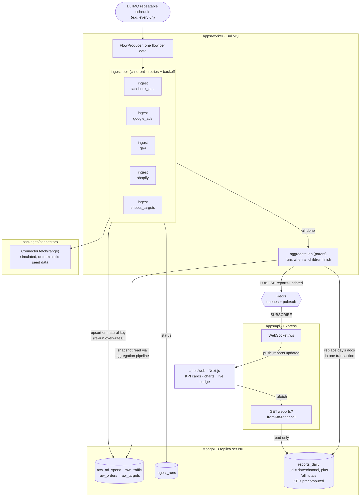

# Pulseboard

[](https://github.com/ThanhcongMssl/pulseboard/actions/workflows/ci.yml)

A marketing analytics pipeline and dashboard. Scheduled jobs ingest ad spend, web traffic, orders
and targets from five sources, precompute daily KPIs per channel (spend, revenue, ROAS, CAC,
conversion rate) into MongoDB, and serve them to a dashboard that refreshes live when new numbers
land.

**Live demo: [pulseboard-opal.vercel.app](https://pulseboard-opal.vercel.app)** (free hosting: the
first visit after a quiet spell takes up to a minute while the API wakes up).

TypeScript monorepo · Node.js + Express · BullMQ + Redis · MongoDB replica set · Next.js 16 +
React 19 + Tailwind 4 + Recharts · Vitest · Docker Compose · GitHub Actions

## Quick start

**Everything in Docker** (needs only Docker):

```sh
docker compose up -d --build --wait
docker compose run --rm worker node dist/backfill.js 30   # queue 30 days of history
# dashboard: http://localhost:3000
```

**Local development** (Node 24, pnpm via `corepack enable`, Docker for the databases):

```sh
pnpm install
cp .env.example .env
pnpm db:up     # MongoDB replica set + Redis only
pnpm dev       # api :4000, worker, web :3000 (hot reload)
pnpm backfill  # in a second terminal: queue the last 30 days (or `pnpm backfill 90`)
```

Both setups use ports 3000 and 4000, so run one at a time. Data sources are simulated (see
[Connectors](#connectors)), so no API keys are needed. The worker re-ingests today and yesterday
every `INGEST_EVERY_MINUTES` (default 360). To watch retries and stale-data handling, set
`CONNECTOR_FAILURE_RATE=0.3`, which makes about 30% of connector fetches fail.

## Hosted demo

The public demo runs entirely on free tiers:

| Piece            | Host                                    | Notes                                                 |
| ---------------- | --------------------------------------- | ----------------------------------------------------- |
| Dashboard        | Vercel                                  | Static Next.js build calling the API from the browser |
| API + worker     | Render free web service (`render.yaml`) | One container: `infra/start-all.mjs` runs both        |
| Queues + pub/sub | Render Key Value (free)                 | In-memory, `noeviction`, private network only         |
| Database         | MongoDB Atlas free cluster              | A replica set, so transactions work as locally        |

Free hosting changes a few things, on purpose:

- **Render's free tier has no background workers**, so the api and worker share a container. A small
  supervisor starts both, forwards shutdown signals, and exits if either dies so Render restarts it.
- **It sleeps after 15 minutes without traffic.** The first visit wakes it, which takes up to a
  minute, and the dashboard says so while it waits. The worker sleeps too, so scheduled
  ingests only run while the service is awake.
- **The database starts empty**, and there's no shell to run `pnpm backfill`. With `SEED_DAYS=90`,
  the worker queues 90 days of history at boot, but only when there are no reports yet, so a
  restart never re-ingests the history.
- **Key Value is in-memory**, so a restart loses queued jobs. Nothing depends on them surviving:
  the schedule is re-created at boot, and re-ingesting a day is idempotent.

### Deploy your own

1. **Atlas:** create a free cluster, a database user, and allow access from `0.0.0.0/0` (Render's
   free services have no fixed IPs). Copy the `mongodb+srv://…` connection string and **add the
   database name** to its path: `…mongodb.net/pulseboard?retryWrites=true&w=majority`.
2. **Render:** _New → Blueprint_, pick this repo, and enter `MONGO_URL` when prompted. For
   `WEB_ORIGIN`, use `http://localhost:3000` for now.
3. **Vercel:** import the repo with root directory `apps/web`. Set `NEXT_PUBLIC_API_URL` to the
   Render URL (`https://<service>.onrender.com`) and `NEXT_PUBLIC_WS_URL` to the same host with
   `wss://` and `/ws`.
4. **Render again:** set `WEB_ORIGIN` to the Vercel URL so the API's CORS allows the dashboard.

## Architecture



1. A repeatable schedule starts one flow per date: five ingest jobs (children) and one aggregate job
   (parent) that BullMQ holds until every child has finished.
2. Each ingest job pulls from its connector and upserts raw rows on a natural key, so re-running a
   day never double-counts. If a source still fails after its retries, the aggregate runs anyway with
   that source's last good data, and `ingest_runs` flags it as stale.
3. The aggregate reads the raw data at one snapshot and replaces the day's `reports_daily` documents
   in a single transaction, so readers never see half-updated totals.
4. It then publishes to Redis. The API relays that to open dashboards over WebSocket, and they
   refetch precomputed reports, so no KPI math happens at request time.

## Design decisions

**Precompute a read model instead of aggregating per request.** Reports change a few times a day but
are read constantly. The aggregate job writes one denormalized `reports_daily` document per day and
channel, plus an `all` totals row, with every KPI already computed
([`buildDailyReports`](apps/worker/src/reports.ts)). The API only reads (CQRS-style): a 90-day
dashboard is one indexed range query, and no KPI math runs at request time.

**A queue between sources and reports.** Each source is its own BullMQ job with retries and
exponential backoff, so a slow or failing API never blocks the others. A
[flow](apps/worker/src/flows.ts) makes the aggregate job the _parent_ of the five ingest jobs:
BullMQ holds it until every child has finished, which guarantees completeness without
coordination code. Per-source rate limits would be a BullMQ limiter on the ingest queue.

**Idempotent by construction.** Every raw collection has a natural key, for example
`(source, orderId)`, enforced by a unique index. Ingest writes only through
[`upsertMany`](packages/db/src/upsert.ts), and connectors return the same records for the same day.
Re-running a day, by retry, schedule or backfill, overwrites rows and never double-counts.

**Snapshot reads, transactional writes.** The aggregate reads a day's raw data in a snapshot
session, so a late retry landing mid-read can't skew the sums. It then replaces the day's six
report documents and its campaign documents in one transaction, so a dashboard never sees new
channel rows next to an old totals row, or campaigns that disagree with their channel. Transactions are why MongoDB runs as a (single-node) replica set.

**Stale beats blocked.** If a source still fails after its retries, the flow lets the aggregate run
anyway on that source's last good data, and the report records it in `staleSources`. The dashboard
stays complete and shows a banner, instead of freezing because one upstream API is down.

**Live updates through Redis pub/sub, not change streams.** The worker knows exactly which dates
and channels it rebuilt, so it publishes that as an event. The API relays it over WebSocket, and
the dashboard invalidates only the cached TanStack Query entries whose date range contains a rebuilt
day. A burst from a backfill is debounced into one invalidation, and a reconnect invalidates
everything in case events were missed. Data never goes stale on a timer, because the push is the
freshness signal.

**Numbers that add up.** Money is integer cents end to end, and days are UTC `YYYY-MM-DD` strings.
Ratios over a range or across channels are computed from summed totals and never averaged, so
blended ROAS is all revenue over all spend, and a quiet day doesn't weigh as much as a busy one.

## Trade-offs and scaling

- **Freshness versus cost.** Reports are at most one schedule interval old. The schedule
  re-ingests only today and yesterday, because older days rarely change. Late corrections to
  older days need a backfill. A real deployment would re-pull a trailing window sized to each
  source's attribution delay.
- **Rebuilding a whole day** is simple and obviously correct at this size (hundreds of orders a
  day). At millions of rows a day, the aggregate would merge per-source partial sums instead of
  re-reading every raw row.
- **At 100× scale:**
  - Redis pub/sub is fire-and-forget. A durable log (Kafka, Redis Streams) would let consumers
    replay missed events.
  - `reports_daily` would shard on `{ channel, date }`.
  - Ingest workers scale out horizontally, with per-source rate limiters protecting upstream
    quotas.
  - Multi-tenant data would add a tenant id to every key and index.
- **No auth.** It's a demo dashboard; the API is read-only and allows CORS from the dashboard's
  origin only.

## Dashboard

Open http://localhost:3000 once a backfill has run.

- **Filters**: 7, 30 or 90 days or custom dates, a single channel or all of them, a campaign, and
  a comparison with the previous period. They live in the URL
  (`/?from=2026-10-01&to=2026-10-14&channel=paid_social&campaign=fb_2&compare=prev`), so any view
  can be linked. Every change is a history entry, so back and forward step through an analysis.
- **Widgets**: KPI tiles (revenue against the prorated target, ad spend, ROAS, CAC, conversion
  rate, orders; with all channels selected, ROAS is _blended_), each with a sparkline and a value
  that counts to its new number when the data changes, daily revenue against target and
  spend, daily revenue stacked by channel, and tables of channels, campaigns and every order in
  the range (virtualized, sortable by date or revenue, loading keyset pages as you scroll).
- **Cross-filtering and drill-down**: click a channel's bars, legend entry or table row to focus
  the whole dashboard on it, and a campaign row to narrow the orders to that campaign. A
  breadcrumb (All channels › Paid social › Retargeting) leads back up.
- **Zoom**: drag across the revenue chart to zoom into those days. The chip under the filters zooms
  back out.
- **Compare**: KPI tiles show the change against the previous period of the same length, colored
  by whether it's good news (CAC going up isn't), and the revenue chart overlays the previous
  period. Ratios compare range ratios built from totals, and a period with missing days shows no
  change rather than a misleading one.
- **Command palette and shortcuts**: ⌘K (Ctrl+K) reaches every range, channel, campaign, view and
  layout action by name. Single keys do the common ones (1/2/3 for 7/30/90 days, C compare, E edit
  layout, T theme), and ? lists them.
- **Layout builder**: _Edit layout_ lets you drag widgets by their header, resize them from the
  corner, remove them, and add more from the widget library. From the keyboard, focus a widget's
  grip and use the arrows to move it, Shift+arrows to resize; a live region says where it landed. Every change is a snapshot in an
  undo history (⌘Z / ⇧⌘Z, or Ctrl+Z / Ctrl+Y), and _Reset_ is undoable too. The layout saves to
  the API after a pause under an anonymous client id kept in localStorage, so it follows the
  browser without an account. A save still pending when the tab closes goes out with `keepalive`.
- **Live updates**: the dashboard listens on `/ws` and invalidates only the cached queries whose
  date range contains a rebuilt day; a saved layout is never refetched under you. When a rebuild
  touches the range on screen, a toast says which days and channels changed. The badge reconnects
  with backoff and shows how old the data is.
- **Accessibility**: each chart is named by a one-sentence summary (totals, best and worst day, or
  each channel's share) and has a _Table_ view of the same numbers. The orders table keeps table
  semantics while virtualized (`aria-rowcount` against the server's total). Muted text meets WCAG
  AA contrast, every widget has its own loading, empty and error state, and motion respects
  `prefers-reduced-motion`.
- **Phones**: the grid becomes one column in reading order, editing is hidden, and the filters
  collapse into a bottom sheet behind a _Filters_ button that counts the active ones.
- **Stale banner**: shown when a day's numbers come from a source's last good data.
- **Performance**: Lighthouse on the production build (`next build && next start`, default layout,
  30 days) scores **94–99 on desktop** (LCP ≈ 0.95 s, TBT ≈ 80 ms, CLS 0.005) and **70–75 on
  mobile**. The mobile run simulates a mid-range phone at 4× CPU slowdown, and its ≈ 1 s of
  main-thread work is mostly React and Recharts rendering the two charts. Accessibility and best
  practices score 100 on both. The charts, the orders table and the command palette load in their
  own chunks (`next/dynamic`), the palette only when first opened; the KPI sparklines are a single SVG path each rather than chart components, and
  the scrollbar gutter is reserved so the page doesn't shift sideways when data arrives.

The browser calls the API directly. Next.js reads `.env` from `apps/web/`, not the repo root, and
the defaults point at `localhost:4000`. To use another API, set `NEXT_PUBLIC_API_URL` and
`NEXT_PUBLIC_WS_URL` in `apps/web/.env.local`, and `WEB_ORIGIN` for the API's CORS.

## API

Reports come from precomputed read models (`reports_daily`, `reports_campaign_daily`), so no
request aggregates raw data. The order list reads `raw_orders` directly, and layouts are the API's
only write.

| Endpoint                                                       | Returns                                                                                                                                       |
| -------------------------------------------------------------- | --------------------------------------------------------------------------------------------------------------------------------------------- |
| `GET /reports?from&to&channel`                                 | Daily rows sorted by date, plus a range `summary` per channel. Defaults to the last 30 days and every channel; ranges are capped at 366 days. |
| `GET /campaigns?from&to&channel`                               | Range totals per ad campaign (spend, delivery, attributed orders and revenue, ROAS, CAC, CTR), largest spend first.                           |
| `GET /orders?from&to&channel&campaignId&sort&dir&limit&cursor` | One page of orders sorted by `date` or `revenue`, with `nextCursor` for the next page and the matching `total` on the first page.             |
| `GET /layouts/:clientId`, `PUT /layouts/:clientId`             | A viewer's saved dashboard layout (`204` before the first save), keyed by an anonymous client id (a UUID); the last write wins.               |
| `GET /status`                                                  | `lastComputedAt` and the last finished ingest attempt of each source, for a "last updated" badge.                                             |
| `GET /health`                                                  | Mongo and Redis reachability (`200` or `503`).                                                                                                |
| `WS /ws`                                                       | `{"type":"hello"}` on connect, then `{"type":"reports.updated","dates":[…],"channels":[…],"computedAt":…}` after every rebuild.               |

```sh
curl 'localhost:4000/reports?from=2026-10-01&to=2026-10-29&channel=paid_social'
curl 'localhost:4000/campaigns?channel=paid_search'
curl 'localhost:4000/orders?sort=revenue&limit=50'
curl localhost:4000/status
```

Invalid queries get `400 {"error":"invalid_query","issues":{…}}`. Range ratios in `summary` are
computed from the range's totals, not averaged across days. The `all` row's ROAS is _blended_: all
revenue over paid spend. CAC is null for channels without ad spend.

**Orders are keyset-paginated.** A cursor encodes the last row's sort value and `_id`, and the next
page continues strictly after it, walking an index in either direction. A page costs the same at
row 100,000 as at row 0, and orders ingested between requests can't shift pages into duplicates or
gaps. Walking all 530 pages of ~106k orders returns each order exactly once, in order, at about
5 ms a page.

## Connectors

The five sources (Facebook Ads, Google Ads, GA4, Shopify, Google Sheets targets) are **simulated**:
deterministic generators that derive spend, traffic and orders from one shared model of demand.
The numbers move together plausibly: weekday patterns, slow growth, ROAS around 2–4. A real
integration implements the same interface and changes nothing downstream:

```ts
interface Connector<TRecord> {
  readonly source: Source;
  fetch(range: DateRange): Promise<TRecord[]>; // same range → same records, keyed for upserts
}
```

Connector output is validated with zod before it's written.

## Project layout

```
apps/api            Express REST + WebSocket relay (reads read models and orders; writes layouts)
apps/worker         BullMQ: schedule, ingest flows, aggregate job, backfill script
apps/web            Next.js dashboard
packages/shared     Domain types, zod schemas, KPI math, API and event contracts (no I/O)
packages/db         Mongo client, typed collections, indexes, idempotent upserts
packages/connectors The Connector interface and the five simulated sources
```

## Testing

- **Unit tests (Vitest, 95 tests):** KPI math, date helpers, report building, range summaries,
  flow construction, upsert operations, connector determinism and keys, API query validation,
  the WebSocket relay, and the dashboard's view helpers (filters, chart series, formatting).
- **CI** runs format, lint, typecheck, tests and builds on every push. A second job builds the
  Docker images, boots the full stack, backfills a week, and checks that `/reports` returns it.
