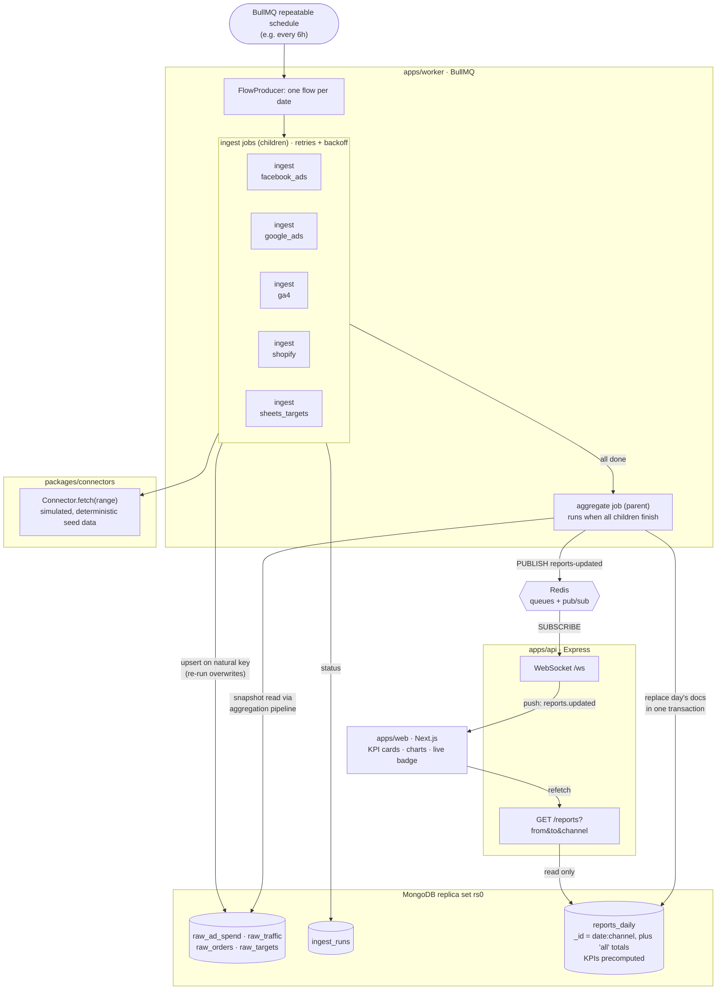

# Pulseboard

Marketing analytics pipeline and dashboard. Scheduled jobs ingest ad spend, web traffic, orders and
targets from five sources, precompute daily per-channel KPIs (spend, revenue, ROAS, CAC, conversion
rate) into MongoDB, and serve them to a dashboard that updates live.

> 🚧 Work in progress. Architecture, design decisions and screenshots are coming.

## Architecture



1. A repeatable schedule starts one flow per date: five ingest jobs (children) and one aggregate job
   (parent) that BullMQ holds until every child has finished.
2. Each ingest job pulls from its connector and upserts raw rows on a natural key, so re-running a
   day never double-counts. If a source still fails after its retries, the aggregate runs anyway with
   that source's last good data, and `ingest_runs` flags it as stale.
3. The aggregate reads the raw data at one snapshot and replaces the day's `reports_daily` documents
   in a single transaction, so readers never see half-updated totals.
4. It then publishes to Redis. The API relays that to open dashboards over WebSocket, and they
   refetch precomputed reports, so no KPI math happens at request time.

## Stack

TypeScript monorepo (pnpm) · Node.js + Express · BullMQ + Redis · MongoDB (replica set) ·
Next.js + React + Tailwind · Vitest · Docker Compose · GitHub Actions

## Run locally

Requires Node 24, pnpm (via `corepack enable`) and Docker.

```sh
pnpm install
cp .env.example .env
pnpm db:up   # MongoDB replica set + Redis
pnpm dev       # api :4000, worker, web :3000
pnpm backfill  # in a second terminal: queue the last 30 days (or `pnpm backfill 90`)
```

Data sources are simulated connectors with deterministic seed data, so no API keys are needed.
The worker re-ingests today and yesterday every `INGEST_EVERY_MINUTES`. To watch retries and stale
sources, set `CONNECTOR_FAILURE_RATE=0.3` in `.env`, which makes about 30% of connector fetches fail.
